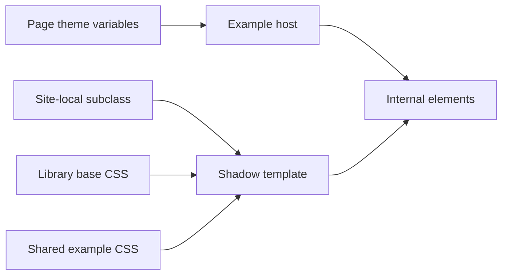

# Requirements

### Goal
Give all examples one shared, shadow-encapsulated stylesheet, using classes and IDs rather than `::part()`. Keep fun/boring and light/dark differences controlled by inherited CSS variables.

### Scope
- Apply the new stylesheet only on the example site, as selected; preserve the library’s default appearance.
- Preserve existing `part` attributes and external `::part()` customization support.
- Retain the examples’ current appearance and interactions, including single/multi-select, datalist output, disabled/error states, dropdown states, and slots.
- Keep page layout and light-DOM/slotted-content styles outside the shadow stylesheet.
- No new public styling API or theme-switching behavior.

# Technical Design

### Existing implementation
`site/demo-styles.css` defines theme variables and approximately 300 lines of component styling through `::part()`. `site/styles.js` switches fun/boring; media queries provide light/dark. `src/much-select.js` creates the shadow template using `this.styleTag`, which already contains the library’s base styles. Elm rendering in `src/MuchSelect.elm` and `src/DropdownOptions.elm` supplies internal IDs and state classes alongside parts.

### Example-only integration
Define a site-local subclass in `site/index.js` and register it under the existing `much-select` name. Override `styleTag` to return `super.styleTag` followed by a stylesheet link to the shared example CSS, resolved relative to `import.meta.url`. This uses the existing template-creation hook, automatically covers dynamically created examples, and requires neither mutation observers nor library lifecycle changes. Keep the existing registration guard.

The stylesheet loads through the browser’s normal CSS caching. Tests must wait for stylesheet loading before checking computed styles; component readiness alone does not guarantee CSS readiness.

### Selector and variable migration
Translate each existing part rule to its actual rendered ID/class, not a mechanical copy of the part name: for example, `#value-casing.output-style-custom-html.multi`, `.option.highlighted`, and `#dropdown-indicator.down`. Use `:host(...)` only where host attributes are genuinely the state source. Audit combined states and specificity against the base stylesheet; preserve the effective cascade, removing duplicate rules only when equivalent.

Reuse existing `--much-select-*` variables. Replace direct palette references and page-specific dependencies in component rules—such as pill borders/highlights, `--form-font`, `--text-color`, and `--example-border-color`—with component-prefixed semantic variables. Set their values or aliases in the existing page theme scopes and provide sensible fallbacks. Keep theme branches outside the shared shadow stylesheet.

Use existing classes/IDs wherever possible. If a rendered element lacks a suitable hook, add only the necessary class in its Elm view, leaving every part unchanged. Ordinary shadow selectors cannot style assigned light-DOM descendants; retain those rules on the page or use `::slotted()` only where appropriate.

### Files
- Add `site/much-select-example.css`: shared internal example rules.
- Modify `site/index.js`: site-local subclass and stylesheet integration.
- Modify `site/demo-styles.css`: retain themes/page rules, add semantic variable mappings, remove migrated part rules.
- Modify Elm views only if selector mapping identifies missing hooks.
- Add `tests/ExamplesWeb/encapsulated-styles.test.html`: browser regression coverage.
- Update `README.md`: explain example-only encapsulation, CSS-variable customization, and retained parts.

`scripts/build-site.sh` already runs Soupault to copy site styles/assets. Verify the new CSS is emitted and its relative URL works on nested pages; do not hand-edit generated `dist` files.

# Testing

### Browser coverage
Follow the existing Web Test Runner patterns in `tests/ExamplesWeb/default-clear-button.test.html` using fixtures, readiness events, and computed-style assertions.
- Verify the demo subclass adds exactly one shared stylesheet per instance, including dynamically created instances.
- Verify inherited variable changes update internal styles without recreating the component.
- Check fun/boring × light/dark through browser color-scheme emulation and theme selection.
- Cover single/multi-select, datalist, disabled/error, highlighted/selected options, pills, and dropdown indicators.
- Verify external `::part()` overrides still work and a plain library instance does not acquire demo styling.
- Check representative slotted examples and nested-page stylesheet URLs.

### Commands
Use matching Devbox tasks: `devbox run build-site`, `devbox run web-test-runner`, `devbox run test`, and `devbox run lint`. Inspect built examples for layout and contrast regressions; compare representative states with the existing site appearance.

# Delivery Steps

### ✓ Step 1: Add example-only shadow stylesheet integration
Example instances load a shared stylesheet without altering the library’s defaults.
- Add `site/much-select-example.css` and a site-local subclass in `site/index.js` using the existing `styleTag` getter.
- Append the example stylesheet after the base styles and resolve its URL relative to the site module.
- Add browser coverage for initial and dynamically created instances, stylesheet readiness, and isolation from plain library instances.
- Verify Soupault emits the asset and nested-page URLs load correctly.

### ✓ Step 2: Migrate internal rules and theme variables
The example component styling uses encapsulated selectors, with theme differences supplied through variables.
- Move component rules from `site/demo-styles.css` into the shared stylesheet, mapping parts to actual Elm-rendered classes and IDs.
- Audit specificity and combined states against base CSS; preserve part attributes and add minimal classes only where needed.
- Introduce component-prefixed variables for remaining palette/page dependencies and map them in the existing theme scopes.
- Keep page layout and assigned light-DOM styling external; remove migrated part rules and redundant declarations.
- Extend browser checks for state styling, variable inheritance, and external part overrides.

### ✓ Step 3: Verify theme parity and document customization
The four theme combinations remain functional and the example styling approach is documented.
- Exercise fun/boring in light/dark with representative single/multi-select, datalist, error, disabled, dropdown, and slotted examples.
- Check computed styles and rendered layouts for cascade or loading regressions, correcting migration issues.
- Update `README.md` with the shared stylesheet location, example-only loading, semantic variables, and continued part support.
- Run applicable build, browser, Elm-test, and lint tasks through Devbox.