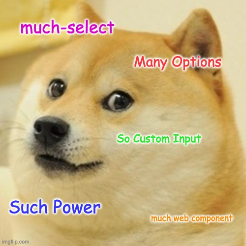

# \<much-select>



A web component - powered by Elm - that will create a powerful select menu.

## Prior Art, Inspiration, and Goals

The project draws heavy inspiration from the jQuery based [selectize.js](https://selectize.github.io/selectize.js/).

The need for this project came about because we were working on an app that used selectize.js a lot. However, we're migrating parts of the app to [Elm](https://elm-lang.org/). Elm needs to "own" the DOM and selectize.js is built in a way that's not compatible with that requirement. 

The goal for this project to achieve near feature parity with selectize.js using web components. The API will be different, so it will not be a drop in replacement, but hopefully it will not be too hard to replace one with the other.

### Other Similar Projects

- [React Select](https://react-select.com/home)
- [inkuzmin/elm-multiselect](https://package.elm-lang.org/packages/inkuzmin/elm-multiselect/)

## Installation

```bash
npm i much-select-elm
```

## Usage

The npm package provides the class `MuchSelect` (which inherits from `HTMLElement`). To use it, use something like the following to define a custom element.

```javascript
import MuchSelect from "@getdrip/much-select-elm";

if (!customElements.get("much-select")) {
  // Putting guard rails around this because browsers do not like
  //  having the same custom element defined more than once.
  window.customElements.define("much-select", MuchSelect);
}
```

## Example Styling

The example site loads `site/much-select-example.css` inside each example component's shadow root, after Much Select's built-in styles. This stylesheet is example-only; registering the library's `MuchSelect` class as shown above keeps the library's default appearance unchanged.

The example stylesheet uses internal IDs and classes, while theme differences are inherited through CSS custom properties. The site's existing `fun`/`boring` and light/dark theme rules map palette values to component variables such as `--much-select-example-focus-border-color` and `--much-select-example-selected-value-border-color`. To customize an example, set supported `--much-select-*` or `--much-select-example-*` properties on the component or an ancestor; they inherit into the shadow root and update without recreating the component.

The component's existing `part` attributes remain available. External `::part()` rules can still customize parts, but the example site's shared component styling no longer depends on them. Page layout and slotted light-DOM content remain styled outside the shadow stylesheet.

### Setting and updating a theme

Set properties directly on the host or inherit them from an ancestor:

```css
much-select.compact {
  --much-select-min-width: 160px;
  --much-select-height: 30px;
  --much-select-border-color: rebeccapurple;
}

.dark-form {
  --much-select-background-color: #222;
  --much-select-dropdown-background-color: #222;
  --much-select-dropdown-option-color: #eee;
  --much-select-dropdown-option-color-inverse: white;
}
```

Properties participate in the normal CSS cascade. Changing a theme class or a property updates existing components without recreating them:

```javascript
const select = document.querySelector("much-select");
select.style.setProperty("--much-select-border-color", "teal");
select.style.removeProperty("--much-select-border-color");
```

Removing an inline property reveals any matching stylesheet or inherited value, then the fallback below if none is supplied. Use valid values for the consuming CSS declaration; a defined but invalid value does not select the `var()` fallback.

`--much-select-height` (with fallback `--much-select-min-height`) sets the host's **minimum** height, not a fixed control height. The example layer also uses it for the value casing and datalist input. Dimension measurement keeps the original 20px casing-height safeguard, lowered when the host's computed minimum height is smaller (`Math.min(20, parseFloat(getComputedStyle(host).minHeight))`). A large host minimum height does not force the dropdown downward: its top offset remains based on the measured value-casing height. The width measurement floor follows the host's computed `min-width`.

### Custom property reference

The tables inventory the `var()` declarations in `src/much-select.js` (`styleTag`) and `site/much-select-example.css`. Property names below omit the common `--much-select-` prefix: for example, `border-color` means `--much-select-border-color`, and `example-form-font` means `--much-select-example-form-font`. In fallback columns, `$name` means `var(--much-select-name, …)`; arrows show the complete fallback order. Literal values are CSS values, not additional property names.

**Built-in** is the library declaration's fallback; **Example** is the example stylesheet's declaration fallback, not a theme palette value. `—` means that layer has no declaration for that row (built-in rules still apply). Different selectors and specificity can override another row, so these are declaration references rather than guaranteed computed values in every state. Example theme rules can define the `example-*` properties before these terminal fallbacks are reached.

#### Host, casing, and filter input

| Selector / declaration | Property | Built-in fallback | Example fallback |
| --- | --- | --- | --- |
| `:host` min-height | `height` | `$min-height → 40px` | — |
| `:host`, `#wrapper` min-width | `min-width` | `200px` | — |
| `#wrapper` font-family | `font-family` | `inherit` | `$example-form-font → sans-serif` |
| `#value-casing`, datalist input min-height | `height` | — | `$min-height → 2.5em` |
| custom-html casing border-width | `value-casing-border-width` | `1px` | `1px` |
| custom-html casing border-style | `value-casing-border-style` | `solid` | `solid` |
| custom-html casing border-color | `border-color` | `black` | `currentColor` |
| custom-html casing background-color | `background-color` | `transparent` | `#fff` |
| custom-html casing box-shadow | `value-casing-box-shadow` | — | `$example-value-casing-inset-shadow → 1px 1px 1px 0 lightgray inset` |
| custom-html casing padding | `value-casing-padding` | — | `0.1em 2em 0.1em 10px` |
| custom-html error border-color | `error-border-color` | `$border-color → black` | `$border-color → currentColor` |
| disabled casing color | `disabled-color` | `rgb(128, 128, 128)` | — |
| disabled casing opacity | `disabled-opacity` | `0.65` | — |
| custom-html disabled border-color | `disabled-border-color` | `$border-color → rgb(128, 128, 128)` | `$border-color → currentColor` |
| custom-html multi disabled `.value` border-color | `disabled-border-color` | `$selected-value-border-color → $border-color → rgb(128, 128, 128)` | — |
| datalist invalid input background-color | `error-background-color` | — | `transparent` |
| datalist error border | `datalist-error-border` | — | `none` |
| custom-html casing hover outline | `value-casing-hover-outline` | — | `none` |
| custom-html casing hover border-color | `hover-border-color` | — | `$border-color → currentColor` |
| custom-html casing focus outline | `value-casing-focus-outline` | — | `none` |
| custom-html casing focus border-color | `focus-border-color` | — | `$example-focus-border-color → $border-color → currentColor` |
| custom-html single/multi background-image | `value-casing-background-image` | — | `none` |
| custom-html single/multi background-repeat | `value-casing-background-repeat` | — | `repeat-x` |
| single disabled background-image | `disabled-background-image` | — | `none` |
| single disabled background-color | `disabled-background-color` | — | `$background-color → transparent` |
| custom-html filter border | `input-filter-border` | `none` | — |
| custom-html filter outline (also example hover/focus) | `input-filter-outline` | `none` | `none` |
| custom-html filter background (also example hover/focus) | `input-filter-background` | `none` | `none` |
| custom-html filter height | `input-filter-height` | — | `36px` |
| custom-html filter font-size | `input-filter-font-size` | — | `$example-value-font-size → 1em` |
| custom-html filter color | `input-filter-color` | — | `$example-text-color → currentColor` |
| custom-html filter min-width | `input-filter-min-width` | — | `10px` |
| custom-html filter margin | `input-filter-margin` | — | `0` |
| custom-html filter padding | `input-filter-padding` | — | `0 0.8em 0 0` |
| custom-html multi casing margin-top | `selected-values-margin-top` | `5px` | — |

The example's error and disabled casing borders also consume `value-casing-border-width` and `value-casing-border-style`, each with the same `1px` / `solid` fallback as the normal border.

#### Selected values and remove control

Built-in selected-value rows target `#value-casing.output-style-custom-html.multi .value`. Example rows target `#selected-value` and custom-html multi `.value.selected-value` unless marked **multi only**.

| Declaration / state | Property | Built-in fallback | Example fallback |
| --- | --- | --- | --- |
| border-width (example multi only) | `selected-value-border-width` | `2px` | `0.1rem` |
| border-style (example multi only) | `selected-value-border-style` | `solid` | `solid` |
| border-color (example multi only) | `selected-value-border-color` | `$border-color → black` | `$example-selected-value-border-color → $border-color → currentColor` |
| border-radius (example multi only) | `selected-value-border-radius` | `40px` | `0.3rem` |
| background-color | `selected-value-background-color` | `transparent` | — |
| color (example multi only) | `selected-value-color` | `inherit` | `$multi-select-selected-value-color → currentColor` |
| font-size | `selected-value-font-size` | `inherit` | `14px` |
| padding | `selected-value-padding` | `3px 10px` | `0`; multi-only rule: `0 0.25em` |
| text-align | `selected-value-text-align` | — | `center` |
| margin-right | `selected-value-margin-right` | — | `0.1em` |
| margin-left | `selected-value-margin-left` | — | `0.2em` |
| margin-top | `selected-value-margin-top` | — | `0.7em` |
| margin (multi only; overrides preceding margins) | `selected-value-margin` | — | `0.1rem 0.25rem 0.1rem 0` |
| background-image (multi only) | `multi-select-selected-value-background-image` | — | `none` |
| background-repeat (multi only) | `selected-value-background-repeat` | — | `repeat-x` |
| min-width (multi only) | `selected-value-min-width` | — | `0.5rem` |
| min-height (multi only) | `selected-value-min-height` | — | `2rem` |
| highlighted multi background-image | `selected-value-highlighted-background-image` | — | `$example-highlighted-value-background-image → linear-gradient(to bottom, #e1b12c, #fbc531)` |
| highlighted multi background-repeat | `selected-value-highlighted-background-repeat` | — | `repeat-x` |
| `.selected-value-label` padding-top | `selected-value-label-padding-top` | — | `0.09rem` |
| `.value .remove-option::after` content | `remove-option-content` | `"x"` | — |
| remove pseudo-element padding-left | `remove-option-padding-left` | `5px` | — |
| remove pseudo-element margin-left | `remove-option-margin-left` | `6px` | — |
| remove pseudo-element padding-bottom | `remove-option-padding-bottom` | `3px` | — |
| remove pseudo-element border-left-width | `remove-option-separator-border-width` | `1px` | `1px` |
| remove pseudo-element border-left-style | `remove-option-separator-border-style` | `dotted` | `dotted` |
| remove pseudo-element border-left-color | `remove-option-separator-color` | `gray` | `$border-color → currentColor` |

#### Right slot, dropdown indicator, and clear button

| Selector / declaration | Property | Built-in fallback | Example fallback |
| --- | --- | --- | --- |
| `#right-slot-for-all-values-wrapper` right | `right-slot-offset-right` | — | `0` |
| right-slot wrapper width | `right-slot-width` | — | `2.1rem` |
| right-slot wrapper top | `right-slot-offset-top` | — | `0` |
| right-slot wrapper bottom | `right-slot-offset-bottom` | — | `0` |
| right-slot wrapper border-left-width | `right-slot-separator-border-width` | — | `2px` |
| right-slot wrapper border-left-style | `right-slot-separator-border-style` | — | `dotted` |
| right-slot wrapper border-left-color | `right-slot-separator-color` | — | `$border-color → currentColor` |
| `#dropdown-indicator` transform transition duration | `dropdown-indicator-transition-duration` | — | `0.25s` |
| indicator transform transition timing | `dropdown-indicator-transition-timing-function` | — | `ease` |
| indicator transform transition delay | `dropdown-indicator-transition-delay` | — | `0s` |
| `#dropdown-indicator.up` transform | `dropdown-indicator-up-transform` | — | `rotate(270deg)` |
| `#dropdown-indicator.down` transform | `dropdown-indicator-down-transform` | — | `rotate(90deg)` |
| `#clear-button-wrapper` padding | `clear-button-padding` | — | `0.3em 0.5em` |
| clear-button wrapper border-width | `clear-button-border-width` | — | `0.2em` |
| clear-button wrapper border-style | `clear-button-border-style` | — | `solid` |
| clear-button wrapper border-color | `clear-button-idle-border-color` | — | `transparent` |
| clear-button wrapper hover border-color | `clear-button-border-color` | — | `currentColor` |

#### Dropdown, groups, options, and messages

| Selector / declaration | Property | Built-in fallback | Example fallback |
| --- | --- | --- | --- |
| `#dropdown` left | `dropdown-offset-left` | `0px` | — |
| dropdown z-index | `dropdown-z-index` | `10` | — |
| dropdown max-height | `dropdown-max-height` | `300px` | — |
| dropdown background-color | `dropdown-background-color` | `white` | — |
| dropdown border-width | `dropdown-border-width` | `1px` | `0.1rem` |
| dropdown border-style | `dropdown-border-style` | `solid` | `solid` |
| dropdown border-color | `border-color` | `black` | `currentColor` |
| dropdown margin-top | `dropdown-margin-top` | — | `0.2rem` |
| dropdown border-radius | `dropdown-border-radius` | — | `0.3rem` |
| dropdown font-family | `dropdown-font-family` | — | `$font-family → $example-form-font → sans-serif` |
| `.optgroup` color | `dropdown-optgroup-color` | `inherit` | `inherit` |
| optgroup background-color | `dropdown-optgroup-background-color` | `rgb(128, 128, 128)` | `transparent` |
| optgroup font-size | `dropdown-optgroup-font-size` | — | `0.85rem` |
| optgroup font-weight | `dropdown-optgroup-font-weight` | — | `300` |
| optgroup font-family | `dropdown-optgroup-font-family` | — | `$font-family → $example-form-font → sans-serif` |
| optgroup padding | `dropdown-optgroup-padding` | — | `0.2rem` |
| `.option` color | `dropdown-option-color` | `inherit` | `currentColor` |
| option background-color | `dropdown-option-background-color` | `transparent` | `transparent` |
| option font-family | `dropdown-option-font-family` | — | `$font-family → $example-form-font → sans-serif` |
| option padding | `dropdown-option-padding` | — | `0.5rem` |
| option font-size | `dropdown-option-font-size` | — | `$example-value-font-size → 1em` |
| option min-height | `dropdown-option-min-height` | — | `1.2rem` |
| `.option.highlighted` background-color | `dropdown-option-highlighted-background-color` | `black` | `transparent` |
| highlighted option color | `dropdown-option-color-inverse` | `white` | `currentColor` |
| `.option.selected` background-color | `dropdown-option-selected-background-color` | `transparent` | `transparent` |
| selected option color | `dropdown-option-selected-color` | `inherit` | `$dropdown-option-color-inverse → currentColor` |
| `.option.active` background-color | `dropdown-option-active-background-color` | `transparent` | `transparent` |
| active option color | `dropdown-option-active-color` | `inherit` | `$dropdown-option-color-inverse → currentColor` |
| `.option.disabled` color | `dropdown-option-disabled-font-color` | `$dropdown-option-disabled-color → rgb(128, 128, 128)` | `$dropdown-option-disabled-color → currentColor` |
| disabled option background-color | `dropdown-option-disabled-background-color` | `transparent` | `transparent` |
| `.option.disabled.dropdown-message` color | `dropdown-message-color` | `rgb(128, 128, 128)` | — |
| disabled message background-color | `dropdown-message-background-color` | `transparent` | — |
| disabled message / example `.dropdown-message` min-height | `dropdown-message-min-height` | `0` | `1.2rem` |
| disabled message / example `.dropdown-message` padding | `dropdown-message-padding` | `0` | `0.2rem` |
| `.description` font-size | `description-font-size` | `75%` | `0.85rem` |
| description padding | `description-padding` | — | `0.2rem` |
| `.highlight` color | `highlight-color` | `blue` | — |

The example's optgroup, option, message, and description selectors are scoped under `#dropdown`; its normal option and disabled option rules exclude `.dropdown-message`.

#### Footer, errors, loading indicator, and diagnostic log

| Selector / declaration | Property | Built-in fallback | Example fallback |
| --- | --- | --- | --- |
| `#dropdown-footer` color | `dropdown-footer-color` | `inherit` | `currentColor` |
| footer background-color | `dropdown-footer-background-color` | `transparent` | `transparent` |
| footer font-size | `dropdown-footer-font-size` | `inherit` | `50%` |
| footer font-family | `dropdown-footer-font-family` | `inherit` | — |
| footer padding | `dropdown-footer-padding` | `0` | `0.2rem` |
| footer text-align | `dropdown-footer-text-align` | `inherit` | `center` |
| `#wrapper .error-message ul li` color | `error-color` | `red` | `#c23616` |
| error list item list-style | `error-list-style` | `none` | — |
| error list item padding | `error-list-item-padding` | `0px` | `0` |
| error list item font-size | `error-size` | — | `80%` |
| error list item margin | `error-list-item-margin` | — | `0.1rem 0 0 0` |
| `#wrapper .error-message ul` padding | `error-list-padding` | `0px` | `0` |
| error list margin | `error-list-margin` | — | `0 0 0.4rem 0` |
| `slot[name='loading-indicator']` right | `loading-indicator-offset-right` | `5px` | — |
| loading slot top | `loading-indicator-offset-top` | `10px` | — |
| `.default-loading-indicator` height and width | `loading-indicator-size` | `18px` | — |
| loading indicator border-width | `loading-indicator-border-width` | `5px` | — |
| loading indicator border-style | `loading-indicator-border-style` | `solid` | — |
| loading indicator border-color | `loading-indicator-border-color` | `rgba(150, 150, 150, 0.2)` | — |
| loading indicator border-radius | `loading-indicator-border-radius` | `50%` | — |
| loading indicator border-top-color | `loading-indicator-highlight-color` | `rgb(150, 150, 150)` | — |
| loading indicator animation-duration | `loading-indicator-animation-duration` | `1s` | — |
| loading indicator animation-delay | `loading-indicator-animation-delay` | `0s` | — |
| loading indicator animation-iteration-count | `loading-indicator-animation-iteration-count` | `infinite` | — |
| loading indicator animation-timing-function | `loading-indicator-animation-timing-function` | `ease-in-out` | — |
| loading indicator animation-direction | `loading-indicator-animation-direction` | `alternate` | — |
| `#search-keyboard-events #search-keyboard-events-log` width | `search-keyboard-events-log-width` | `100px` | — |

### Styling boundaries

These properties expose visual choices, not every structural declaration. Flex layout and wrapping, positioning modes, dropdown visibility and scrolling, cursor states, filter flex sizing, datalist input width, clear-button box sizing, and the loading animation's `rotate` name and `0`–`360deg` keyframes remain fixed in these stylesheets. Dropdown dimensions and placement also involve runtime measurement; the property reference does not replace that behavior.

The right-slot and loading-slot properties style their internal wrappers or slot placement, not arbitrary slotted content. Style supplied light-DOM content and page layout in your own stylesheet. Existing `::part()` customization remains supported alongside custom properties; the reference does not remove or rename any parts or slots.

## Development

### Pre-requisites

#### devbox
This project manages its development environment with [devbox](https://www.jetify.com/devbox).

Some of the tools devbox will just take care of for you include
 - soupault, a static site generator
 - watchexec, for doing stuff automatically when files change

### Initial Setup

To work on this project, clone the repo to your machine then run the following:

```bash
devbox run npm-install
devbox run elm-tooling-install
```

That should set the table for you, then you can start all the fun stuff by running

```bash
devbox run start
```

Now you can visit http://localhost:1234

### Production Build

To do a production build run

```bash
npm run build-and-test
```

## API

### DOM

#### Attributes

##### `allow-custom-options`

The `allow-custom-options` attribute will allow the user to add new options to the `<much-select>`, not just one of given ones. Of course, you will want to know when that's happened. You might be able to _just_ look at the value, but you might want to know when a custom option has been added too. For that there's the `customValueSelected` event.

This is a boolean attribute, so it's presents means it's true. It's absence means it's false. So the default value for allowing custom options is false.

##### `disabled`

The `disabled` attribute prevents the `<much-select>` from responding to user input. It is supposed to work like disabling any of the standard form elements.

This is a boolean attribute, so it's presents means it's true. It's absence means it's false. So the default is for a `<much-select>` to not be disabled.

##### `events-only`

The `events-only` attribute prevents the `<much-select>` from automatically updating its "light DOM". This is important for using `<much-select>` inside of an Elm app (and possibly other situations too).

This is a boolean attribute, so if the `events-only` attribute is present means it's true. It's absence means it's false. So the default is for a `<much-select>` to not be in events only mode, and it will try to update the light DOM to reflect it's internal state.

##### `max-dropdown-items`

The `max-dropdown-items` attribute sets the maximum number of items that `<much-select>` will attempt to render in the dropdown.

The default value is 1000.

The `max-dropdown-items` attribute needs a positive integer for its value.

This is also not enforced when a `<much-select>` is using the `datalist` `output-style`.

If you set the value of `max-dropdown-items` to `0` there will be no limit. Would  anyone want that? Should it even be allowed?.

##### `multi-select`

The `multi-select` attribute puts the `<much-select>` into multi select mode, which allows the user to select multiple values.

This is a boolean attribute, so if the `mulit-select` attribute is present, the `<much-select>` will be in multi select mode. If not, it will be in the default single select mode.

##### `multi-select-single-item-removal`

The `multi-select-single-item-removal` attribute adds buttons to remove individual selected options. This only works if the `<much-select>` is in multi select mode.

This is a boolean attribute, so if the `multi-select-single-item-removal` is present the `<much-select>` will have the selected option removal buttons visible. If not, the default behavior is to not show them. 

##### `option-sorting`

The `option-sorting` attribute allows you to specify what order the options should appear in the dropdown.

The options for this are:
 - `no-sorting` (default) respect the value the options are in already
 - `by-option-label` sort the options alphabetically by their label

##### `output-style`

The `output-style` attribute allows you to change the way a `<much-select>` is rendered, which give it a different look and feel. Hopefully you can find one that matches the user experience that best fits your circumstances.

The options for this are:
 - `custom-html` (default)
 - `datalist`

`custom-html` give you a lot of power to style the `<much-select>` but a lot of the markup in hand rolled and an attempt to feel like the user is expecting but even our best effort here will probably fall short.

`datalist` uses the datalist feature of the `<input>` element to render the dropdown part. This can work well if you want to allow the user to type in a text field in a more free form way, and you want to make it easy for them to select a value they might want. It also uses more native widgets. Multi select mode can take up a lot of vertical space though.

##### `placeholder`

The `placeholder` attribute is used to set the placeholder in the text input of the `<much-select>`. Just like in the `<input type="text">` it should only show up if the input is empty.

##### `search-string-minimum-length`

The `search-string-minimum-length` attribute is used to manage how many characters a user needs to type in the `#input-filter` before the options in the dropdown start being filtered.

##### `selected-option-goes-to-top`

The `selected-option-goes-to-top` attribute lets you change the behavior of `<much-select>`, so that when an option is selected it appears at the top of the dropdown menu. This only works when its `output-mode` is `custom-html` and it's in single select mode.

##### `selected-value`

The `selected-value` attribute is used to set the value of the `<much-select>`.

You should _not_ use this in combination with using `selected` attributes on the `<option>` tags in the `select-input` slot. You should just pick one place in the DOM to track the selected value.

##### `selected-value-encoding`

The `selected-value-encoding` attribute is used to change how the values work in the `selected-value` attribute.

The options for this attribute are:
 - `comma` (default) the selected options are comma delegated
 - `json` the selected options are encoded in JSON and `encodeURIComponent()`

`comma` is the most straight forward but if you allow values that have commas in them things are not going to go well. As far as I can tell `json` can handle any kinds of text values, however it is a bit harder to just look at and know what the selected value is.

`json` encoding is recommended.

##### `show-dropdown-footer`

The `show-dropdown-footer` attribute is used to show the footer in the dropdown of the `<much-select>`. The footer contains potentially useful information about how many options are really available but might not be visible because the results are being filter.

#### Options

### Events

##### `valueChanged`

This event fires any time the value changes.

##### `valueCleared`

This event fires if the `<much-select>` is cleared.

##### `optionSelected`

This event fires if the `<much-select>` is in single or multi select mode, but it's _mostly_ for multi select mode. It will just have the newly selected option in it (not all the selected options like the `valueChanged` event).

##### `optionDeselected`

This event fires if the `<much-select>` is in single or multi select mode, but it's _mostly_ for multi select mode.
It will just have the newly deselected option in it. This is kinda of the inverse of the `optionSelected` event.
This event will only fire if an option is delected (or removed). If you just select a different value (like in a single select)
it will not fire.

This could be useful in single select mode if a field is required. It has a value, then that value gets removed, and you want to provide feedback right away to the user that they just blanked out the field, but it is required.

##### `inputKeyUp`

This event fires every time a user types in the `#input-filter` for filtering the options.

##### `inputKeyUpDebounced`

This event fires every time a user types in the `#input-filter` but is debounced by half a second. The idea here is if you want to hook a `<much-select>` up to an API you can use this event to kick off your API calls to add additional options based on what the user is has "searched" for.

##### `customValidateRequest`

This even is used when a custom validator is in play. All too often, in the real world validation is complicated. It might even be dependent on an API call, for example, ensure the value is unique. In these cases you have the option to just call a JavaScript function. Do whatever you need to validate the value and then send the results back to the `<much-select>` element.

**WARNING:** As I'm sure you can imagine this is fraught. If you do _not_ communicate back to much-select the result of validation much-select will hang in a state of limbo until it gets back the result of the validation. If this ends up taking a long time or fails, or times out, or fails in some other way, it's up _you_ to make sure something reasonable happens.

The even will have a couple of values in the `detail` that will be important:
 - `stringToValidate`: This is what the user typed in for the custom value that you'll be validating
 - `selectedValueIndex`: This is just a number. You need to hang on to it to pass it back is time to share the results of your validation with your much-select element.

The way you communicate the result of the validation is a little unconventional. You build a JavaScript object with the following fields: 
 - `isValid`: Boolean
 - `stringToValidate`: String
 - `selectedValueIndex`: Index
 - `errorMessages`: Array objects with they keys
   - `errorMessage`: String
   - `level` : String (could be `error`, `warning`, or `silent`)

`isValid` is pretty straight forward, if the value passed your custom validation is valid this should be true, otherwise it should be false.

`stringToValidate` is also something you _probably_ just want to send back as is. In theory though, you could "fix" it for the user if that makes sense, but maybe think carefully if you're going to do that. You don't want to surprise your users.

`errorMessages` are for giving the user feedback as to why the value then entered is invalid. You can have multiple messages in case there's more than one thing wrong. TODO What are the different levels for?

The final step is to encode this object as JSON and set it to the value of an element with a slot named `custom-validation-result`. You probably want to have that element be a `script` with a type of `application/json` to keep everything nice.  

```html
<script type="application/json" slot="custom-validation-result">
```

Here's an example code of what the JavaScript could look like:

```javascript
// Get the much-select element
const muchSelect = example.querySelector("much-select");

// Listen for event.
muchSelect.addEventListener("customValidateRequest", (event) => {
  const { stringToValidate, selectedValueIndex } = event.detail;
  let result;
  if (stringToValidate === "milk") {
    result = {
      isValid: false,
      value: stringToValidate,
      selectedValueIndex,
      errorMessages: [{ errorMessage: "No milk!", level: "error" }],
    };
  } else {
    result = {
      isValid: true,
      value: stringToValidate,
      selectedValueIndex,
    };
  }
  const customValidationResultSlot = muchSelect.querySelector(
    "[slot='custom-validation-result']"
  );
  customValidationResultSlot.innerText = JSON.stringify(result);
});
```

As you can see, this is a little awkward, if you find your self doing a lot of this you might want to write a library for much-select to make this easier. 

### Slots

There are a lot of special [slots](https://developer.mozilla.org/en-US/docs/Web/HTML/Global_attributes/slot) that much-select uses for various purposes. They are all optional.

#### `select-input`

One of the easy ways to populate a much-select with values and even selected values is to use the `select-input` slot. This lets you use the `<select>` html element. It can be great if you're using `<much-select>` to enhance an existing `<select>`.  

```html
  <much-select multi-select="true" selected-value="Blue">
    <select slot="select-input">
      <option>Red</option>
      <option>Yellow</option>
      <option>Blue</option>
    </select>
  </much-select>
```

##### `clear-button`

If you want to drop in your own custom clear button, you can do that.

```html
  <much-select multi-select="true" selected-value="Blue">
    <div slot="clear-button">✿</div>
  </much-select>
```

##### `loading-indicator`

If you want to drop in your own custom loading indicator you can do that. Maybe a nice animated SVG.

##### `hidden-value-input`

If you need the value of a `<much-select>` work correctly in the middle of a plain old HTML form this slot is very useful. You put it on a hidden input value, and `<much-select>` will keep the hidden input value up to date with the value of the `<much-select>`.

The value for the input will respect whatever you set in the `selected-value-encoding` attribute.

This will _not_ work if the `events-only` attribute is set, because updating the value of hidden input would mean modifying the DOM (other than the Shadow DOM) so we won't do it. If you want this hidden input value to updated and the light DOM left alone you can just handle it your self in some sort of wrapping library where you listen for the relevant events.  

```
  <much-select selected-value-encoding="json">
    <input slot="hidden-value-input" type="hidden" name="my-special-value">
  </much-select>
</div>
```

##### `no-options`

If there are no options to display, show this message.

##### `no-filtered-options`

If the user has typed in a search filter that just does not have any good matches show this message.
```
<much-select>
 <div slot="no-filtered-options">
  What? You don't want that.
 </div>
</much-select>
```
#### `transformation-validation`

It would be great if the folks using our app always entered in information correctly, alas, they often do not, and we need to validate that information.

The first thing that could happen to the input is that you can "transform" it automatically. There are some cases (and be carful with this) where you can "just fix" the input. Maybe the most common example of this would be to trim trailing whitespace. If you have an input and there's just not good reason why anyone would want trailing whitespace you can just trim it up.

The transformations happen before the validations.

The built-in transformations are:
 - `lowercase`: make all the uppercase letters lowercase.
 - `trim-trailing-whitespace`: TODO

**WARNING:** These are all frontend, browser validations, the real validation should happen in a backend somewhere, but in browser validation can help improve the experience of your users by showing them problems right next to where they're trying to input something and hopefully give them some guidance for how to fix their errors.

This slot is a place where you can define how you would like the users input to be validated. The validators are all defined in JSON. much-select has some built in validators and in those don't do the job, there's an escape hatch to a custom validator.

The built-in validators are:
 - `no-white-space`
 - `minimum-length`
 - `custom`
 - _More to come_

Here's an example what the JSON can look like:

```json
{
  "transformers": [
    {
      "name": "lowercase"
    }
  ],
  "validators": [
    {
      "name": "no-white-space",
      "level": "silent",
      "message": "Spaces are not allow for custom fruit."
    },
    {
      "name": "minimum-length",
      "level": "silent",
      "minimum-length": 3,
      "message": "The minimum length is 3."
    }
  ]
}
```

The transformation and validation slot can be a pain to work with. If you need to do a lot of this you probably want a library that wraps much-select to make working with this easier.

#### `custom-validation-result`

This is an element where you can put the results of a custom validation.

```html
<script type="application/json" slot="custom-validation-result">
```

#### Custom Element Options

If you want to start putting custom markup per option in the dropdown, there's a way to do that, but well... buyer beware.

TODO Add a section on the custom elements that can go inside a `<much-select>`.
